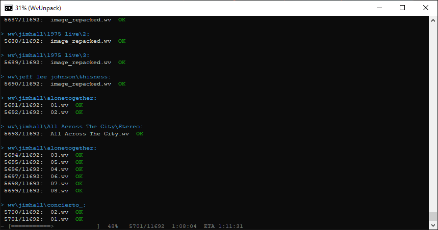

# checkwv

A fast, parallel WavPack (`.wv`) integrity checker for Windows, written in Go. It is a thin, friendly front end for the official `wvunpack` verifier, with a CheckWavpackFiles-style display.

## Why this exists

[CheckWavpackFiles](http://gl.tter.org) by gl.tter was the go-to tool for scanning a whole music library for corrupt WavPack files. It has not been updated since 2008 and is built on WavPack 4.50, so it can't read newer files. In particular, **it can't check DSD files** (for example, SACD rips stored as WavPack).

`checkwv` fills that gap. It doesn't reimplement any decoding. It runs the current official `wvunpack` (5.x) on every file, so it understands everything WavPack 5.x understands, including DSD, and it adds what the original lacked: multi-process scanning, a progress bar with ETA, and an optional warning for files that carry no MD5 checksum.

## Features

- **DSD support.** Uses `wvunpack` 5.x, so DSD `.wv` files are verified like any other.
- **Parallel checking.** `--threads N` verifies N files at the same time. On a large library this is the difference between a long wait and a short one.
- **Real verification.** Every block's CRC is checked, and the stored MD5 is compared with the decoded audio when the file has one (`wvunpack -vv`).
- **Optional missing-MD5 warning.** With `--md5`, files that decode fine but have no internal MD5 are flagged in yellow and listed separately. Some encoders, such as REAPER's built-in WavPack writer, don't store one. It's off by default because most healthy files without an MD5 are not a problem, and it costs an extra `wvunpack` call per file.
- **Familiar display.** Per-folder headers, `n/total` counters, and green `OK` / yellow warning / red `BAD` results, plus an animated progress bar with percent, elapsed time and ETA.
- **Unicode paths.** The console is switched to UTF-8 while it runs, so Japanese, Chinese and other file names display correctly. The previous code page is restored on exit.
- **Live result lists.** Bad files go to `BadFiles.txt`, and (with `--md5`) files without an MD5 go to `NoMD5Files.txt`. Entries are written the moment they are found, so the lists survive Ctrl-C or a crash. Both are written to the first scan folder and are UTF-8 with a BOM, so Notepad shows the names correctly.
- **Script-friendly.** Exit code 0 means no bad files, 1 means at least one bad file, and 2 means `wvunpack` wasn't found. Colors and animation turn off automatically when the output is redirected.
- **Safe scanning.** Skips `$RECYCLE.BIN` and `System Volume Information`, and any folder it can't read.
- **Single executable.** No runtime or installer, just `checkwv.exe` plus `wvunpack.exe`.

## Requirements

- Windows 10 or later (uses the console's ANSI color support)
- `wvunpack.exe` from the official WavPack 5.x tools: <https://www.wavpack.com>
- Go 1.19 or later, only if you want to build it yourself

## Build

```
go mod init checkwv
go build -o checkwv.exe
```

## Usage

```
checkwv.exe [--threads N] [--plain] [--md5] [--wvunpack PATH] [folder-or-file ...]
```

Examples:

```
checkwv.exe D:\music
checkwv.exe --threads 4 D:\music
checkwv.exe --md5 D:\music
checkwv.exe --threads 2 "D:\music" "E:\DSD"
checkwv.exe --wvunpack "C:\Program Files\foobar2000\wavpack\wvunpack.exe" D:\music
checkwv.exe --plain D:\music > log.txt
```

With no path, the current folder is scanned. You can pass several folders and individual files.

### Options

| Option | Description |
| --- | --- |
| `--threads N` | Number of files to verify at the same time (default 4). On a spinning hard disk, 2 or 3 can be faster than 4 because there is less seek thrashing. On an SSD, higher values may help. |
| `--wvunpack PATH` | Path to `wvunpack.exe`. By default `checkwv` looks next to its own executable first, then in `PATH`. |
| `--md5` | Also warn about files that have no internal MD5 checksum. This adds one quick `wvunpack -s` call per file that passes. |
| `--plain` | No colors or animation. This is applied automatically when output is redirected. |

## How it works

1. It scans the given paths for `.wv` files and sorts them folder by folder. A spinner shows the running count, so the total (and therefore the ETA) is exact before checking begins.
2. It runs `wvunpack -vv <file>` on each file, N at a time. This decodes the whole file without writing any output, checking block CRCs and the stored MD5 when present. A non-zero exit code means the file is bad, and the first line of `wvunpack`'s error message is shown.
3. With `--md5`, for files that pass it also runs `wvunpack -s <file>`, which only reads the file's header information. If there is no `original md5:` line, the file gets a yellow warning.
4. Bad files (and, with `--md5`, files without an MD5) are appended to `BadFiles.txt` / `NoMD5Files.txt` as they are found. At the end it prints a summary.

Hybrid files (`.wv` plus `.wvc`) are verified with the correction file when it sits next to the `.wv`, as `wvunpack` does by default.

## Output



## Notes

- The list files are written to the first scan folder, in roughly the order the files are checked. If that folder isn't writable, they go to `%TEMP%\TEMP_BadFiles.txt` and `%TEMP%\TEMP_NoMD5Files.txt`. A list file from an earlier run is overwritten only when the new run finds an entry for it, so delete old lists first if you don't want a stale one to be mistaken for new results.
- A file with no MD5 isn't unchecked, because its block CRCs are still verified. The MD5 adds a whole-stream check on top of that.
- Press Ctrl-C to stop. The console is restored on exit.
- `checkwv` is Windows-only because it uses the Windows console API for colors and UTF-8 output.

## Related

`Add-WavpackMD5.ps1` is a companion PowerShell 7 script. It reads `NoMD5Files.txt` and rewrites those files with an MD5 checksum, verifying each result and preserving all timestamps.

## Credits

- Inspired by CheckWavpackFiles by gl.tter.
- Verification is done by `wvunpack` from the WavPack project by David Bryant: <https://www.wavpack.com>
